<div align="center">


**See through the monsoon: NISAR radar change detection, explained**

[](https://github.com/jeevankumar-m/terra-trace/stargazers) [](https://github.com/jeevankumar-m/terra-trace/watchers) [](https://github.com/jeevankumar-m/terra-trace/network/members) [](#deploy-to-vercel) [](https://www.spaceappschallenge.org/2026/)

Team Dhruva · NASA Space Apps Challenge 2026 · *Dancing with the SARs*

</div>

---

## Table of Contents

- [Overview](#overview)
- [Key Features](#key-features)
- [Screenshots](#screenshots)
- [What the Radar Found](#what-the-radar-found)
- [System Architecture](#system-architecture)
- [Repository Structure](#repository-structure)
- [Prerequisites](#prerequisites)
- [Quick Start](#quick-start)
- [Deploy to Vercel](#deploy-to-vercel)
- [Frontend Setup](#frontend-setup)
- [Backend Setup (optional live mode)](#backend-setup-optional-live-mode)
- [Analysis Pipeline (CLI)](#analysis-pipeline-cli)
- [API Reference](#api-reference)
- [Static Export](#static-export)
- [How to Add New NISAR Data](#how-to-add-new-nisar-data)
- [Testing Guide](#testing-guide)
- [Science Method Summary](#science-method-summary)
- [Honesty Rules and Limits](#honesty-rules-and-limits)
- [Troubleshooting](#troubleshooting)
- [Data Sources and Credits](#data-sources-and-credits)
- [License](#license)

---

## Overview

Monsoon cloud hides India's farmland from optical satellites for weeks at a time, exactly when farmers, agriculture officers and disaster teams most need to see it. **TerraTrace** uses radar from the **NASA–ISRO NISAR mission** (S-band, L2-GCOV), which sees through cloud, day or night. It turns two radar passes into a map and a story anyone can read: **where the land surface changed, how sure we are, and why**.

The first study covers the **Cauvery delta, Tamil Nadu**, India's "rice bowl" (10,506 km²). The two NISAR passes are **6 → 18 October 2026**, the onset of the northeast monsoon. A second, 10 m study zooms into the **Vedaranyam swamp and Point Calimere**.

TerraTrace reports **radar-response change candidates**, not causes. Every region carries its evidence, a hypothesis for the physical driver, and what radar alone cannot prove.

The platform has two execution modes:

- `Static mode` (default): every result is precomputed and frozen into `frontend/public/data`. The web app needs **no backend** and deploys to Vercel as a static site.
- `Live mode`: the FastAPI backend serves analyses and renders map tiles on demand from Cloud-Optimized GeoTIFFs. Use it while developing or running new analyses.

---

## Key Features

- **Pair QA gate**: 20 checks (band, product, track, frame, orbit direction, bandwidth mode, polarization, CRS, grid alignment, overlap, date order, mask semantics, valid coverage). A failed pair is never compared.
- **Change detection**: 10·log10 dB, ΔHH, ΔHV and Δ(HH/HV), a robust median/MAD z-score, 8-connected regions above a minimum mapping unit, and area from the real geotransform.
- **Regional scale**: a decimating reader (`--decimate 5`) runs a whole 10,500 km² delta at 50 m in about 80 seconds and constant memory, straight from 11 GB HDF5 frames.
- **Evidence for every region**: a pattern label (HH-dominant, HV-dominant, dual-channel, ambiguous), an evidence level with reasons, a plain-language summary, "what it does not prove", and provenance.
- **Honesty check**: analyst flags for likely radio-frequency interference (31 regions, 3,762 ha in the delta). They are shown dashed and excluded from the totals.
- **Ancillary context**: daily rainfall at 12 delta towns around both passes (Open-Meteo / ERA5) and a Sentinel-2 cloudless colour basemap.
- **Five-view web app**:
  - **Story**: a guided 7-chapter tour.
  - **Explore**: change map plus the evidence inspector.
  - **Compare**: before/after swipe with ▶ play.
  - **Insights**: rainfall, area by type, histograms and the top regions.
  - **Method**: the processing steps, the radar physics, sources and limits.
- **Colour radar composites** built per tile: dual-pol RGB (HH, HV, HH/HV) for each date, plus an HH change composite (red = darker, cyan = brighter).
- **Exports**: GeoJSON, CSV and a one-page HTML evidence report for every analysis.
- **Landing page** that explains the project in 30 seconds.

---

## Screenshots

### 1. Landing Page

The public front door at `/`, which explains the project in 30 seconds. The full page is collapsed below, followed by each section.

<details>
<summary><b>View the entire landing page (full length)</b></summary>

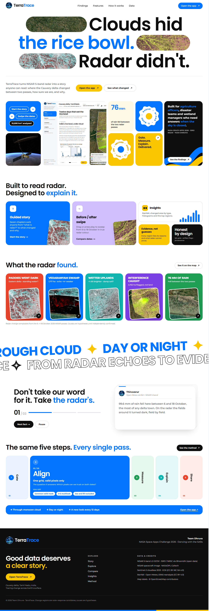

</details>

#### 1a. Hero
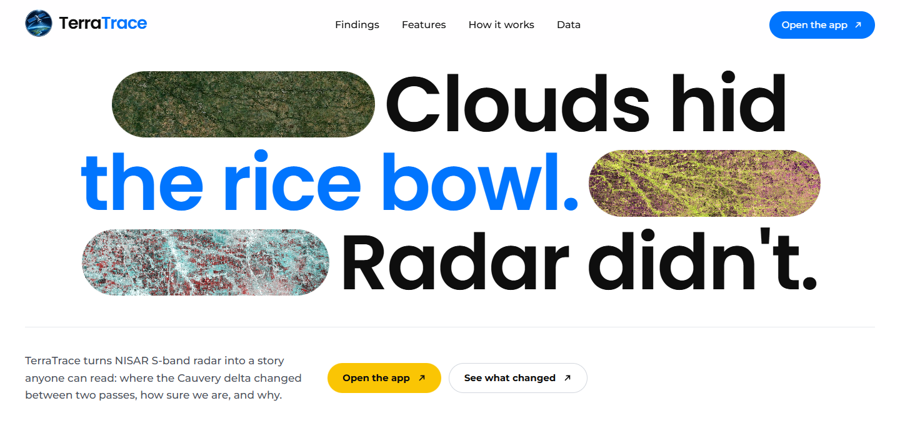

"Clouds hid the rice bowl. Radar didn't." The three image capsules are real data: a Sentinel-2 view of the delta, the NISAR S-band colour radar composite, and the radar change map (red = darker after the rain).

#### 1b. Bento Grid
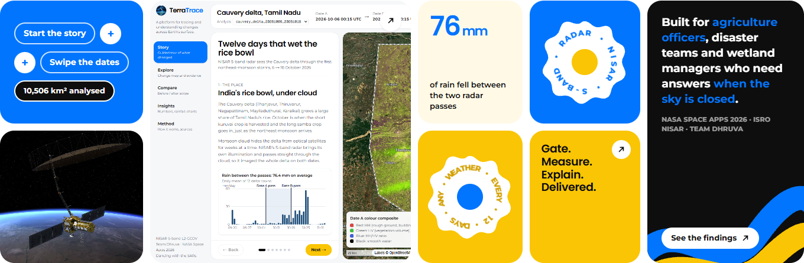

Quick entry points (start the story, swipe the dates), the app itself, NASA's NISAR spacecraft, 76 mm of rain between the passes, spinning badges and who the tool is for.

#### 1c. Features
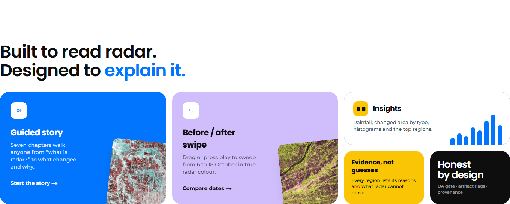

"Built to read radar. Designed to explain it.": the guided story, before/after swipe, insights, evidence, and honesty by design.

#### 1d. What the Radar Found
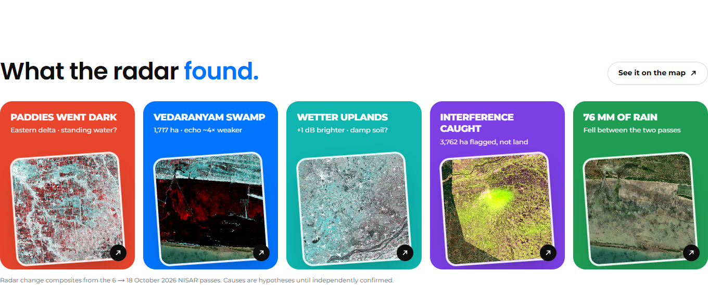

Five findings, each with a real crop from the analysis: dark paddies, the Vedaranyam swamp, wetter uplands, the interference we caught, and the rain.

#### 1e. Marquee
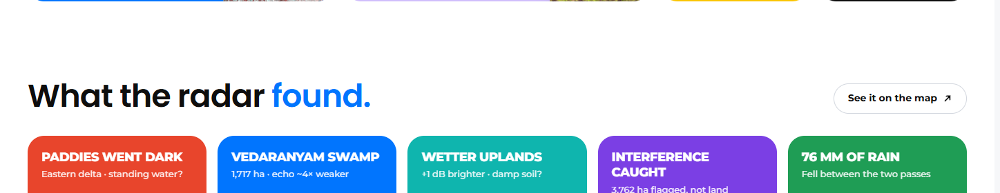

"Through cloud ✦ Day or night ✦ Every 12 days", the reason radar matters during the monsoon.

#### 1f. Take the Radar's Word
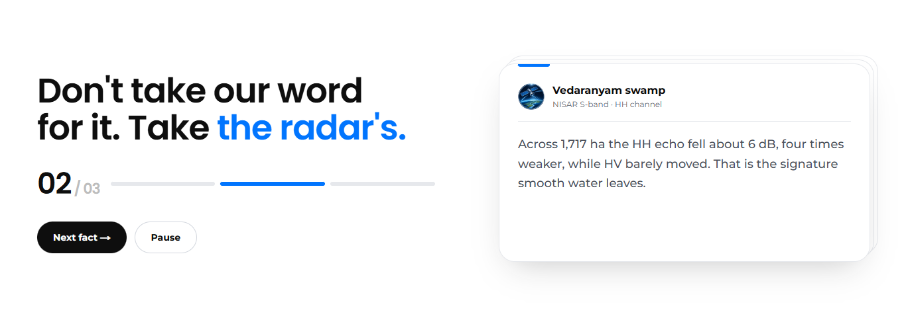

Three rotating facts taken straight from the data (Thiruvarur rainfall, the swamp's 6 dB drop, the flagged interference), with progress bars and Next/Pause controls.

#### 1g. The Same Five Steps
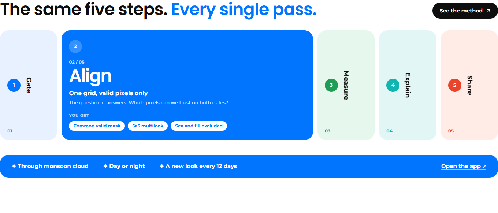

Gate → Align → Measure → Explain → Share as expanding cards, each listing the question it answers and what you get.

#### 1h. Footer
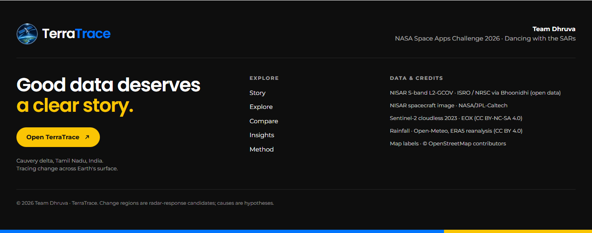

"Good data deserves a clear story.", with app links, Team Dhruva / NASA Space Apps 2026, and full data credits.

---

### 2. Story: India's Rice Bowl, Under Cloud
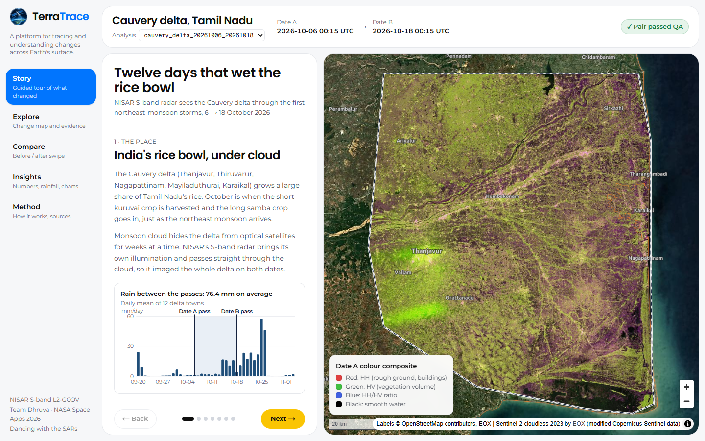

The guided tour opens on the whole Cauvery delta in NISAR dual-pol colour (red = HH, green = HV, blue = HH/HV ratio). The rainfall chart marks both radar passes: 76 mm fell between them on average.

---

### 3. Story: Where the Delta Went Dark
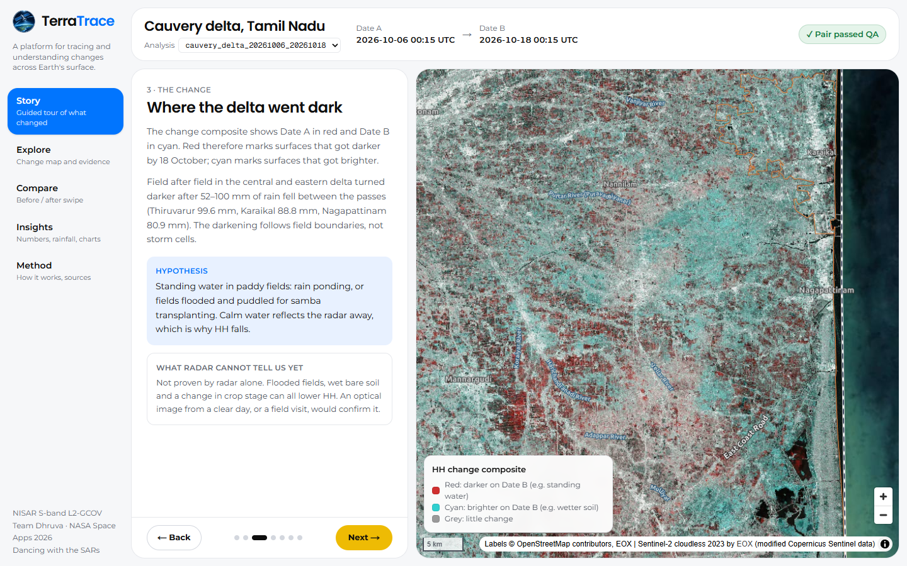

The HH change composite over the eastern delta: red fields got darker between 6 and 18 October. Each chapter states a **hypothesis** (standing water in paddy fields) and **what radar cannot tell us yet**.

---

### 4. Story: Not Every Change Is Real
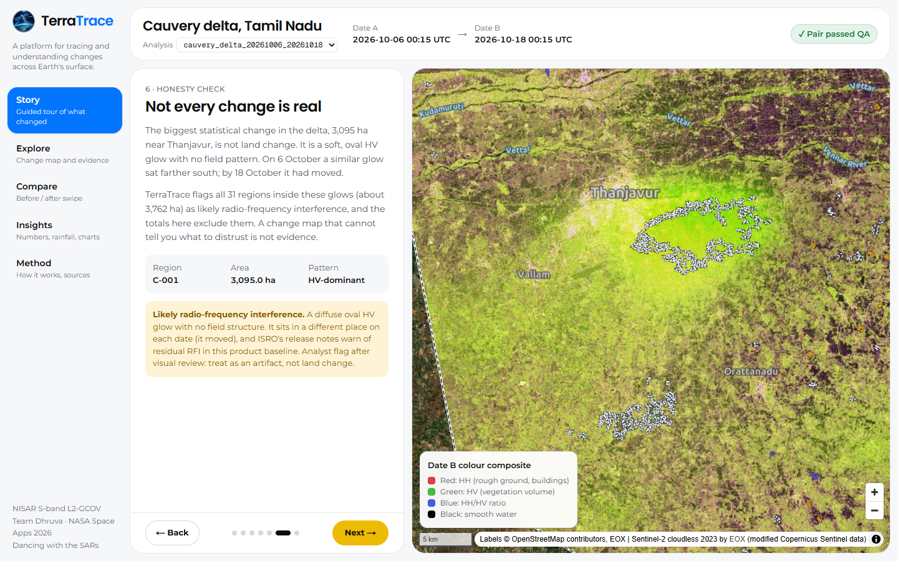

The largest statistical change, 3,095 ha near Thanjavur, is a moving glow of radio-frequency interference, not land change. TerraTrace flags it instead of reporting it.

---

### 5. Explore: Change Map
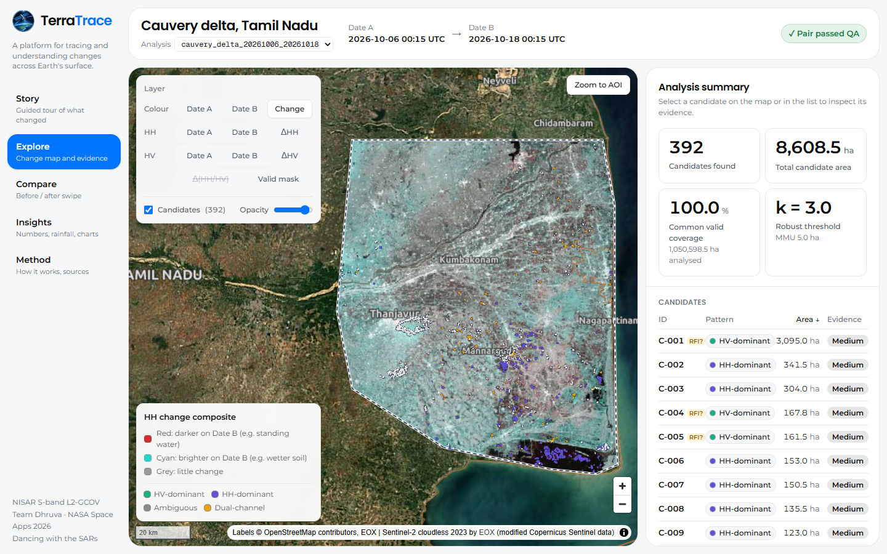

The full change map on a satellite basemap, with a colour / HH / HV layer switcher, candidate outlines coloured by pattern, a legend, and the analysis summary with sortable candidates. "RFI?" marks flagged artifacts.

---

### 6. Explore: Evidence Inspector
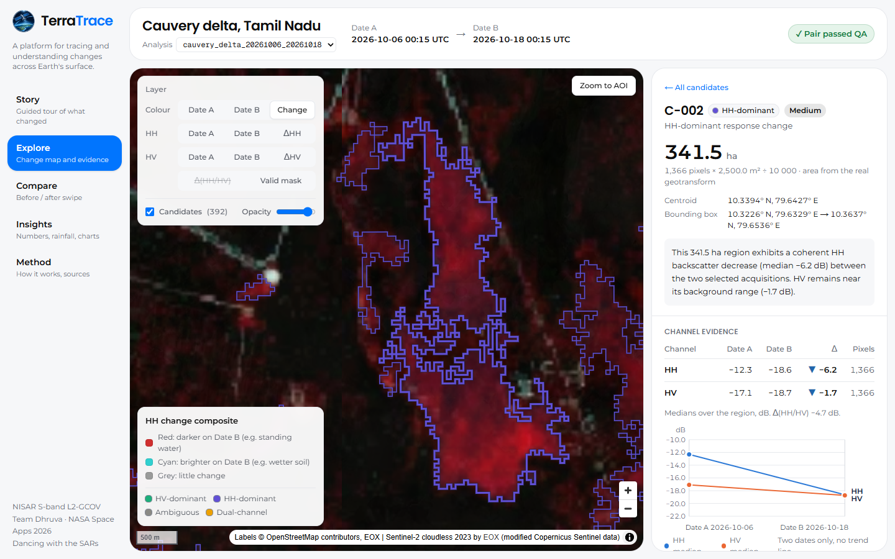

One region in detail: area (pixels × real pixel area), centroid and bounding box, a plain-language summary, a channel evidence table and a two-date chart, plus the evidence checklist and provenance further down.

---

### 7. Compare: Before / After Swipe
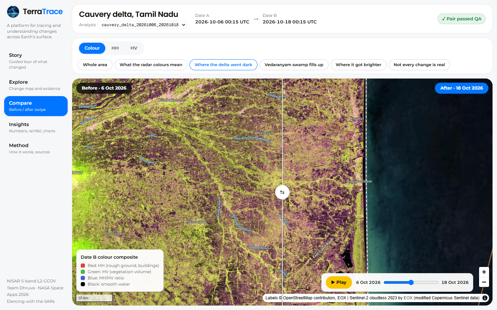

Two synchronised maps with a draggable divider and a ▶ Play sweep from 6 to 18 October. One-click jumps go to each story hotspot. Colour, HH and HV modes are available.

---

### 8. Insights
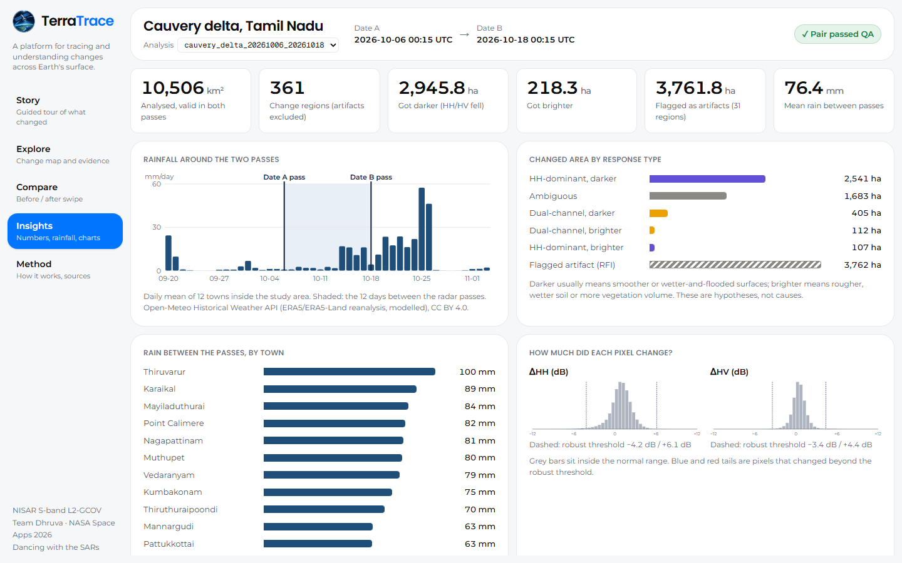

Headline numbers (10,506 km² analysed, 361 change regions after artifacts are excluded), daily rainfall with both passes marked, rain by town, changed area by response type, ΔHH/ΔHV histograms with the robust threshold, and the largest regions.

---

### 9. Method
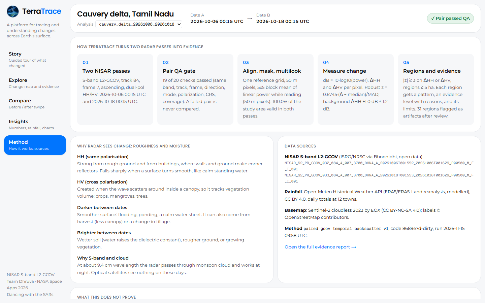

The five processing steps filled in with this run's real numbers, why radar sees roughness and moisture, every data source with exact scene IDs, and what the analysis does not prove.

---

### 10. Vedaranyam Swamp at 10 m
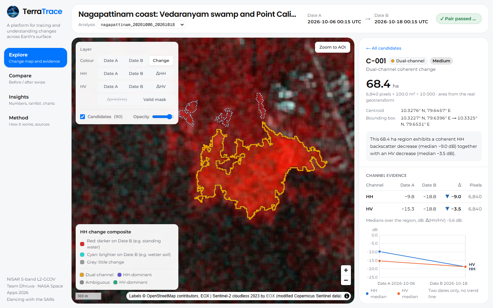

The second analysis at full 10 m resolution (5 × 5 multilook). A 68.4 ha region in the swamp: HH fell 9.0 dB and HV fell 3.5 dB, classified as a dual-channel coherent decrease.

---

## What the Radar Found

Pair: `NISAR_S2_PR_GCOV_032_084_A_007_3700_DHNA_A_20261006T001552…` → `NISAR_S2_PR_GCOV_033_084_A_007_3700_DHNA_A_20261018T001553…` (track 84, ascending, frame 7, dual-pol HH/HV, CRID P00500). Pair QA passed, fallback level A.

| Finding | Numbers | Hypothesis (not proven by radar alone) |
|---|---|---|
| Eastern-delta paddies went dark | 84 darkening regions, 1,029 ha (Thiruvarur–Nagapattinam), 52–100 mm of rain between passes | Standing water from rain ponding, or fields flooded for samba transplanting |
| Vedaranyam swamp darkened | 55 regions, 1,717 ha, HH about −6 dB (four times weaker), HV nearly flat | A thin, smooth sheet of water spreading across mudflats and salt pans |
| Western uplands brightened | Delta-wide median ΔHH +0.97 dB | Wetter soil: water raises the dielectric constant |
| Interference caught | 31 regions, 3,762 ha near Thanjavur, glow moved between dates | Radio-frequency interference, flagged and excluded |

Totals: 10,506 km² analysed (100 % valid in both passes), 392 regions found, 361 after artifact flags.

---

## System Architecture

- Analysis pipeline: Python in `analysis/` (h5py, rasterio, NumPy, SciPy, Shapely).
- Backend (live mode): `FastAPI` in `backend/main.py`, with in-process `rio-tiler` map tiles from COGs.
- Frontend: `Next.js 16` + `Tailwind 4` + `MapLibre GL 5` in `frontend/`.
- Static data (default mode): `frontend/public/data/…`, written by `analysis/export_static.py`.

Data flow:

1. Two NISAR S-band L2-GCOV HDF5 files are inspected; their file-name fields are cross-checked against internal metadata.
2. The pair QA gate validates comparability. A failed pair stops before any change is computed.
3. Both scenes are windowed to the AOI on one grid (optionally decimated) with a joint valid-pixel mask.
4. dB layers, deltas, robust z-scores and candidate regions are computed and written to `data/derived/<id>/`.
5. `analysis.context` adds rainfall; `data/stories/<id>.json` adds the guided story and analyst flags.
6. The backend serves these files, or `export_static` freezes them into the frontend.
7. The frontend renders the Story, Explore, Compare, Insights and Method views.

---

## Repository Structure

```text
terra-trace/
├── analysis/
│   ├── config.py            # every tunable number (thresholds, MMU, multilook, mask codes)
│   ├── inspect_product.py   # HDF5 / GeoTIFF reader, file-name decoding + cross-check, SHA-256
│   ├── validate_pair.py     # pair QA gate (20 checks, readable reasons)
│   ├── prepare_gcov.py      # AOI window, alignment, joint valid mask, Decimated reader
│   ├── compare_pair.py      # 10·log10 dB, multilook, deltas, COG writer
│   ├── detect_candidates.py # robust median/MAD z-score, regions above MMU
│   ├── summarize.py         # per-region stats, pattern label, evidence reasons
│   ├── run_analysis.py      # CLI: one analysis end to end -> data/derived/<id>/
│   ├── catalog.py           # pair gate over a folder of downloads
│   ├── context.py           # rainfall context (Open-Meteo) -> context.json
│   ├── export.py            # GeoJSON / CSV / HTML evidence report
│   └── export_static.py     # freeze the API + map tiles into frontend/public/data
├── backend/
│   ├── main.py              # FastAPI: analyses, candidates, tiles, composites, exports, story, context
│   └── schemas.py           # Pydantic v2 response models
├── frontend/
│   ├── app/                 # / (landing) and /app (workspace)
│   ├── components/          # Landing, Workspace, MapView, MapPanel, Inspector, Views, Charts, Logo
│   ├── lib/tt.ts            # types, data access (static/live), formatting, interpretation copy
│   └── public/              # brand/, landing/ images, data/ (static API + tiles)
├── data/
│   ├── aoi/                 # study-area GeoJSON (committed)
│   ├── stories/             # guided story + analyst flags per analysis (committed)
│   ├── raw/                 # NISAR HDF5 downloads (gitignored)
│   └── derived/             # analysis outputs (gitignored)
├── tests/                   # pytest: pipeline + API on synthetic fixtures
├── docs/                    # methods, decisions, data acquisition, progress, screenshots
├── Makefile · tasks.ps1     # task runner (tasks.ps1 for Windows without make)
└── requirements.txt         # pinned Python dependencies
```

---

## Prerequisites

- **Viewing or deploying the app**: Node.js 20+ and pnpm. Nothing else; the data ships in the repo.
- **Running analyses** (optional): Python 3.11+ (developed on 3.13), and about 25 GB of free disk per NISAR pair.
- **Getting new NISAR S-band data** (optional): a free Bhoonidhi account (ISRO/NRSC).

---

## Quick Start

The fastest way to see everything, with no backend:

```bash
cd frontend
pnpm install
pnpm dev
```

Open:

- Landing page: `http://localhost:3000`
- App: `http://localhost:3000/app`

---

## Deploy to Vercel

The app is fully static by default, so nothing runs on a server.

1. Push this repository to GitHub.
2. In Vercel: **Add New → Project → Import** the repository.
3. Set **Root Directory** to `frontend`. Framework preset: **Next.js** (auto-detected). Install command: `pnpm install`.
4. **Do not** set `NEXT_PUBLIC_API_BASE`. Leaving it unset is what selects static mode.
5. Deploy. `/` is the landing page and `/app` is the workspace.

What gets served: two prerendered pages plus `public/data/` (about 67 MB): 3,267 WEBP map tiles, every JSON response, and the GeoJSON/CSV/HTML exports for both analyses.

---

## Frontend Setup

```bash
cd frontend
pnpm install
pnpm dev                                                # static mode (default)
NEXT_PUBLIC_API_BASE=http://127.0.0.1:8000 pnpm dev     # live mode, needs the backend
pnpm build && pnpm start                                # production build
```

On Windows PowerShell, live mode is: `$env:NEXT_PUBLIC_API_BASE="http://127.0.0.1:8000"; pnpm dev`.

### Frontend Pages

| Route | View | Description |
|---|---|---|
| `/` | Landing | Hero, bento grid, features, findings, the five steps, data credits |
| `/app` | Story | Guided 7-chapter tour with hypotheses, caveats and the rainfall chart |
| `/app` | Explore | Change map, layer switcher, candidate outlines, evidence inspector, QA drawer, exports |
| `/app` | Compare | Before/after swipe, ▶ Play sweep, timeline slider, hotspot jumps |
| `/app` | Insights | KPIs, rainfall, rain by town, area by response type, histograms, top regions |
| `/app` | Method | Processing steps with this run's numbers, radar physics, sources, limits |

`/app?analysis=<id>` opens a specific analysis.

---

## Backend Setup (optional live mode)

```bash
python -m venv .venv
.venv/Scripts/pip install -r requirements.txt          # Linux/macOS: .venv/bin/pip
.venv/Scripts/python -m uvicorn backend.main:app --host 127.0.0.1 --port 8000
```

Or use `make api`, or `powershell -ExecutionPolicy Bypass -File tasks.ps1 api` on Windows.

Health check:

```bash
curl http://127.0.0.1:8000/api/health
```

```json
{ "status": "ok", "analyses": 4, "data_dir": ".../terra-trace/data" }
```

Interactive docs: `http://127.0.0.1:8000/docs`. On Windows use `127.0.0.1`, not `localhost` (`localhost` costs about 2 s per request through the IPv6 fallback).

---

## Analysis Pipeline (CLI)

```bash
# 1) Pair gate over a folder of downloads
python -m analysis.catalog data/raw/nagapattinam_vedaranyam --aoi data/aoi/cauvery_delta.geojson

# 2) Whole-delta analysis at 50 m (5x5 block mean while reading), MMU 5 ha
python -m analysis.run_analysis \
  --scene-a data/raw/.../NISAR_S2_PR_GCOV_032_084_A_007_..._20261006T001552_..._P00500_M_F_I_001.h5 \
  --scene-b data/raw/.../NISAR_S2_PR_GCOV_033_084_A_007_..._20261018T001553_..._P00500_M_F_I_001.h5 \
  --aoi data/aoi/cauvery_delta.geojson --analysis-id cauvery_delta_20261006_20261018 \
  --decimate 5 --mmu-ha 5

# 3) Rainfall context
python -m analysis.context cauvery_delta_20261006_20261018

# 4) Freeze everything for the static web app
python -m analysis.export_static
```

Options: `--decimate N` (regional runs), `--mmu-ha` (minimum mapping unit), `--force-exploratory` (compute deltas for a failed pair, everything labelled exploratory), `--no-hash` (skip SHA-256). Omit `--scene-b` for a single-scene view (fallback level C).

Outputs per analysis in `data/derived/<id>/`: `manifest.json`, `scene_a.json`, `scene_b.json`, `pair_qa.json`, `metrics.json`, `candidates.geojson`, `context.json`, and `cog/*.tif` (+ `cog/audit/` linear power).

---

## API Reference

Base URL (live): `http://127.0.0.1:8000`. In static mode the same paths are served from `/data<path>.json`, and tiles and exports keep their file extensions.

### 1) `GET /api/analyses`

Lists analyses with the default (a real, QA-passed one is preferred over synthetic).

```json
{
  "default_analysis_id": "cauvery_delta_20261006_20261018",
  "analyses": [
    {
      "analysis_id": "cauvery_delta_20261006_20261018", "area_name": "Cauvery delta, Tamil Nadu",
      "status": "ok", "fallback_level": "A", "synthetic": false, "exploratory": false,
      "date_a": "2026-10-06T00:15:52.963963Z", "date_b": "2026-10-18T00:15:53.252646Z", "n_candidates": 392
    }
  ]
}
```

### 2) `GET /api/analyses/{id}`

The full manifest: scenes, pair QA checklist, layers, legend ranges, threshold, background statistics, quality, preprocessing, AOI, bounds, provenance, and the `tiles` URL templates.

### 3) `GET /api/analyses/{id}/candidates`

GeoJSON FeatureCollection of candidate regions (EPSG:4326) with `candidate_id`, `area_ha`, `pattern`, `evidence_level`, `direction`.

### 4) `GET /api/candidates/{id}/{candidate_id}`

```json
{
  "candidate_id": "C-002", "area_ha": 341.5, "pattern": "HH_DOMINANT_CHANGE", "direction": "decrease",
  "evidence_level": "MEDIUM", "centroid_lonlat": [79.642664, 10.3394],
  "statistics": { "delta_hh_median_db": -6.185, "delta_hv_median_db": -1.687, "...": "..." },
  "evidence": [ { "status": "pass", "text": "Pair passed same-track / mode / polarization checks" } ],
  "interpretation_limit": "Radar-response candidate; cause not established",
  "geometry": { "type": "Polygon", "coordinates": [ "..." ] }
}
```

### 5) `GET /api/tiles/{id}/{layer}/{z}/{x}/{y}.png`

256 px map tiles. Layers: `a_hh_db`, `b_hh_db`, `delta_hh_db`, `a_hv_db`, `b_hv_db`, `delta_hv_db`, `delta_ratio_db`, `valid_mask`. The composites are built per tile from the stored dB layers:

| Layer | Colours |
|---|---|
| `rgb_a`, `rgb_b` | R = HH, G = HV, B = HH − HV (dB) |
| `change_hh` | R = Date A HH, G = B = Date B HH → red = darker, cyan = brighter |

### 6) `GET /api/analyses/{id}/export/{name}`

`candidates.geojson`, `candidates.csv` (UTF-8 with BOM for Excel) or `report.html` (one-page evidence report). Every export carries the data label and the interpretation limit.

### 7) `GET /api/analyses/{id}/story` and `GET /api/analyses/{id}/context`

The guided story with analyst flags (from `data/stories/<id>.json`), and the rainfall context (`context.json`).

### 8) `GET /api/analyses/{id}/histogram/{delta_layer}`

```json
{ "edges": [-12.0, -11.5, "...", 12.0], "counts": [ "..." ], "median": 0.97 }
```

Other endpoints: `GET /api/health`, `GET /api/areas`, `GET /api/scenes?area_id=`, `GET /api/pairs?area_id=`.

---

## Static Export

`python -m analysis.export_static` loads the backend in-process and writes the following to `frontend/public/data/`:

- every JSON endpoint the frontend calls;
- all three exports;
- map tiles for the 10 layers the UI uses, from zoom 7 to the data's native zoom (12 for 50 m, 14 for 10 m), encoded as WEBP. Fully transparent tiles are skipped; MapLibre overzooms beyond the native zoom.

Only real, QA-passed analyses are exported, never synthetic or exploratory ones. Options: `--format png|webp`, `--workers N`, `--only <ids>`. Re-run it after any new analysis, story edit or rainfall update.

---

## How to Add New NISAR Data

1. **Download** NISAR S-band L2-GCOV from [Bhoonidhi](https://bhoonidhi.nrsc.gov.in/bhoonidhi/index.html) (free login). Pick two dates with the **same track, frame, direction, bandwidth mode and polarization** (the product name holds all of them). Use the free Open_Data cart, click **Confirm**, then the green download icon. Step by step: [docs/DATA_ACQUISITION.md](docs/DATA_ACQUISITION.md).
2. Put both `.h5` files in `data/raw/<area_id>/` and draw an AOI GeoJSON in `data/aoi/`.
3. Run `analysis.catalog` (pair gate) → `analysis.run_analysis` → `analysis.context`.
4. Optionally write `data/stories/<analysis_id>.json` (chapters plus analyst flags).
5. Run `analysis.export_static` and redeploy.

---

## Testing Guide

```bash
make test            # or: .venv/Scripts/python -m pytest -q   (28 tests)
```

### A) Science pipeline (synthetic fixtures only)
- dB math (10·log10, never 20·log10; no −inf), mask codes and the `validSamplesSubSwathMaskingApplied=False` exception.
- Pair QA: every mismatch type rejects with a readable reason; date order; mixed channels.
- Alignment and warping, area from the geotransform, MMU, implanted-change recovery, multilook never leaking invalid pixels.
- Byte-identical re-runs (reproducibility).

### B) API
- Every endpoint, tiles inside and outside bounds, 404s, colour composites, story/context/histogram, and exports carrying the data label.

### C) Static build without a backend
```bash
cd frontend && pnpm build && pnpm start -p 3100
```
Then open `http://localhost:3100/app` with the API stopped. Every view, tile and export loads from `public/data`.

---

## Science Method Summary

Implemented in `analysis/` (method ID `paired_gcov_temporal_backscatter_v1`):

- Backscatter: `dB = 10 · log10(γ⁰ power)` on both dates (same radiometric convention, never 20·log10).
- Multilook: N × N valid-weighted mean of linear power before dB (5 × 5 at 10 m; a 5 × 5 block mean while reading at 50 m).
- Change: `ΔHH = HH_B − HH_A`, `ΔHV` likewise, `Δ(HH/HV) = ΔHH − ΔHV`. Positive means a stronger echo on Date B.
- Robust anomaly: `z = 0.6745 · (Δ − median) / MAD` over valid pixels. Candidate pixel if `|z| ≥ 3` on ΔHH or ΔHV.
- Regions: 8-connected components ≥ MMU (1 ha at 10 m, 5 ha at 50 m). Area = pixel count × |pixel width × height|.
- Pattern: both channels |z| ≥ k → dual (same sign) or ambiguous; one channel ≥ k with the other < 2 → HH- or HV-dominant.
- Evidence: High / Medium / Low from explicit rules (pair QA, valid neighbourhood ≥ 90 %, channel agreement, size ≥ 5 × MMU, compactness ≥ 0.2). HIGH is reserved until independent corroboration exists.

Units: backscatter in dB, area in hectares, coordinates in WGS84 degrees (display) and UTM 44N metres (area).

---

## Honesty Rules and Limits

- No fabricated scene IDs, dates or metrics. Every number in the app traces to an analysis file.
- Synthetic data lives only in tests and shows a red banner. It is never exported to the static app.
- A region is a **radar-response candidate**. Causes are hypotheses until independently confirmed.
- Two dates show a difference, not a trend; more 12-day passes would separate flooding from crop stage.
- Open sea is excluded (low SNR, wind-driven). Tide state at acquisition is unknown.
- Residual RFI and banding exist in this product baseline. Suspicious regions are flagged, not hidden.

---

## Troubleshooting

### `/app` says "Can't load the TerraTrace data"
- Static mode: `frontend/public/data` is missing. Run `python -m analysis.export_static`.
- Live mode: start the backend and check `NEXT_PUBLIC_API_BASE`.

### Map tiles don't show on Vercel
- Check that the Root Directory is `frontend` and that `public/data/api/tiles/` was committed (it is not gitignored).

### Bhoonidhi login hangs after the OTP email, or the map is blank
- A site-side syntax error in `odap.js` (observed 15 Nov 2026). Workaround in [docs/DATA_ACQUISITION.md](docs/DATA_ACQUISITION.md): a Chrome DevTools Local Override that removes one `)`.

### Slow API on Windows
- Use `127.0.0.1` instead of `localhost`.

### Port already in use
- Another app is on `3000` (Next picks `3001`) or `8000`. In live mode on another port, add it to `TERRATRACE_CORS`.

---

## Data Sources and Credits

- **NISAR S-band L2-GCOV**: ISRO / NRSC via Bhoonidhi (open data). NISAR is a joint NASA–ISRO mission.
- **NISAR spacecraft image**: NASA/JPL-Caltech.
- **Basemap**: Sentinel-2 cloudless 2023 by EOX IT Services (contains modified Copernicus Sentinel data), CC BY-NC-SA 4.0. Labels © OpenStreetMap contributors.
- **Rainfall**: Open-Meteo Historical Weather API (ERA5 / ERA5-Land reanalysis), CC BY 4.0.
- **Specifications**: ISRO NISAR Product Format Document v1.2.1; JPL D-102274 GCOV product specification; ASF NISAR guides.

This project is not an official NASA or ISRO product.

More detail: [Methods](docs/METHODS.md) · [Decisions & sources](docs/DECISIONS.md) · [Data acquisition](docs/DATA_ACQUISITION.md) · [Progress](docs/PROGRESS.md)

---

## License

MIT License

Copyright (c) 2026 M. Jeevan Kumar

Permission is hereby granted, free of charge, to any person obtaining a copy
of this software and associated documentation files (the "Software"), to deal
in the Software without restriction, including without limitation the rights
to use, copy, modify, merge, publish, distribute, sublicense, and/or sell
copies of the Software, and to permit persons to whom the Software is
furnished to do so, subject to the following conditions:

The above copyright notice and this permission notice shall be included in all
copies or substantial portions of the Software.

THE SOFTWARE IS PROVIDED "AS IS", WITHOUT WARRANTY OF ANY KIND, EXPRESS OR
IMPLIED, INCLUDING BUT NOT LIMITED TO THE WARRANTIES OF MERCHANTABILITY,
FITNESS FOR A PARTICULAR PURPOSE AND NONINFRINGEMENT. IN NO EVENT SHALL THE
AUTHORS OR COPYRIGHT HOLDERS BE LIABLE FOR ANY CLAIM, DAMAGES OR OTHER
LIABILITY, WHETHER IN AN ACTION OF CONTRACT, TORT OR OTHERWISE, ARISING FROM,
OUT OF OR IN CONNECTION WITH THE SOFTWARE OR THE USE OR OTHER DEALINGS IN THE
SOFTWARE.
